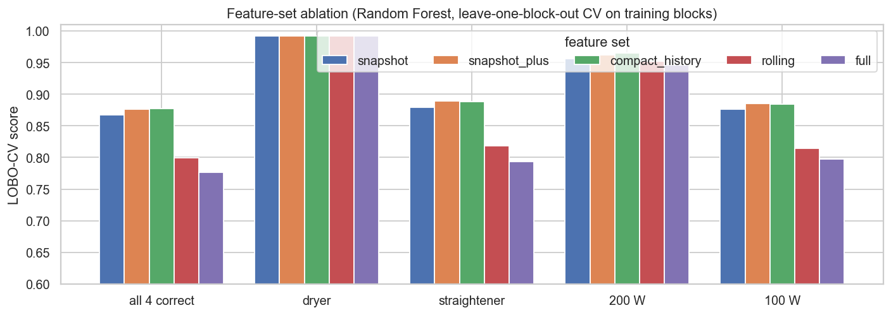
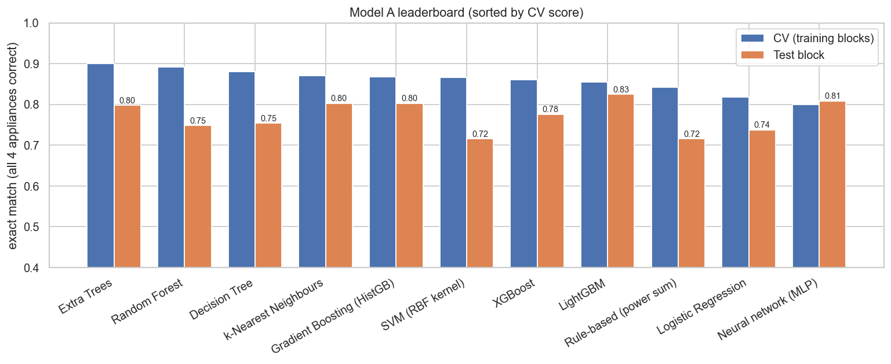
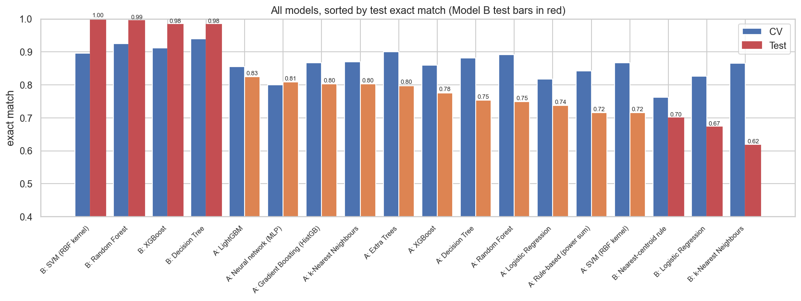
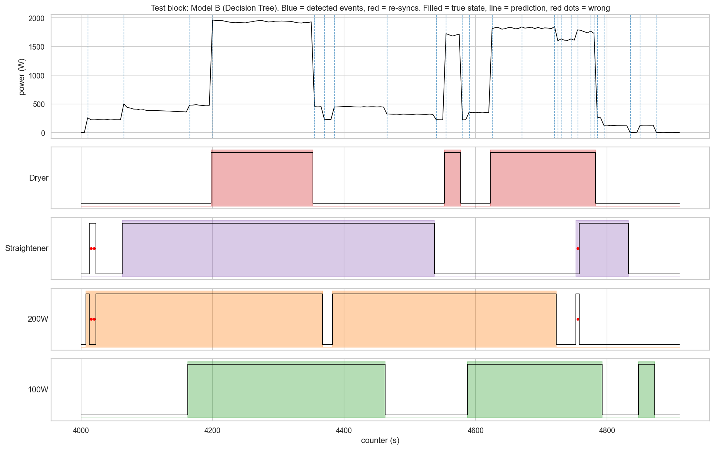

# LoRa SmartMeter Model

Real-time **appliance detection** (non-intrusive load monitoring) from a single smart energy meter.
The meter (STPM33 metering IC on an STM32 NUCLEO-G071RB) measures the total voltage, current, power and power
factor of a socket. The ML model reads that stream (sent over Wi-Fi) and predicts **which of four appliances
are ON** at any moment:

| Appliance | Typical power | Power factor |
|---|---|---|
| Hair dryer | ≈ 1,490 W | 1.00 |
| 200 W bulb | ≈ 227 W | 1.00 |
| 100 W bulb | ≈ 129 W | ≈ 1.00 |
| Hair straightener | 97 – 213 W (falls as it heats) | ≈ 0.96 |

---

## Project pipeline

| Step | Notebook | Status |
|---|---|---|
| 1. Data loading & validation | [`01_data_loading.ipynb`](notebooks/01_data_loading.ipynb) | ✅ Done |
| 2. Exploratory data analysis | [`02_eda.ipynb`](notebooks/02_eda.ipynb) | ✅ Done |
| 3. Feature engineering | [`03_feature_engineering.ipynb`](notebooks/03_feature_engineering.ipynb) | ✅ Done |
| 4. Model A: snapshot classifiers + hyper-parameter tuning | [`04_model_A_snapshot.ipynb`](notebooks/04_model_A_snapshot.ipynb) | ✅ Done |
| 5. Model B: event-based detector | [`05_model_B_event.ipynb`](notebooks/05_model_B_event.ipynb) | ✅ Done |
| 6. Final comparison (incl. hybrid model) | `06_final_comparison.ipynb` | ⏳ Next |
| 7. Real-time Wi-Fi inference | `realtime/` | ⏳ |

---

## Dataset

Recorded on 21 Nov 2026 with firmware v0.3.0, in two sessions (morning and evening). Every one of the
**16 on/off combinations** of the four appliances is present.

- `data/raw/labelled_dataset.csv`: 1,370 labelled samples at a 5-second resolution (1,187 train / 183 test)
- `data/raw/switch_events.csv`: 148 appliance switch events
- `data/raw/*.log`: raw serial-console captures of the meter
- `data/raw/DATASET_README.md`: recording protocol and dataset notes

Source: `latestdataset/` of [abhigyankesri/LoRaWAN-Smart-Meter](https://github.com/abhigyankesri/LoRaWAN-Smart-Meter).

**Model inputs:** power, current and power factor (plus features derived from their recent history).
Voltage, frequency, energy and the sample counter are excluded (see EDA, section 7).

**Evaluation:** hyper-parameters are tuned with *leave-one-block-out* cross-validation (one protocol block per
fold). The final score is measured only on the untouched `F_test` block (free household-style use).

---

## Key EDA findings

**1. Appliance combinations and their power.** The dryer splits the data into two clear groups. Inside each group,
combinations containing the straightener overlap with combinations containing the 100 W bulb.


**2. The hard pair: hair straightener vs 100 W bulb.** Once hot, the straightener draws ≈ 105 – 130 W, inside the
100 W bulb's range. It is easy to recognise at switch-on (surge, then decaying power), which motivates an
event-based model.


**3. Switch-on signatures.** At the moment of switching, the bulbs give a clean step, the straightener a surge, and
the dryer a huge step.


**4. Loads are additive.** Total power ≈ sum of the individual appliance powers (residual spread ≈ ±18 W), so a
power-sum consistency check can correct the event-based model.


More charts: [`reports/figures/`](reports/figures/)

---

## Feature engineering

25 **causal** features (they only use the current and past samples), computed by one shared function
([`src/features.py`](src/features.py)) for both training and the live stream. Replaying the test log sample by
sample through the streaming builder gives exactly the same features as the offline computation.

| Group | Features | Idea |
|---|---|---|
| Base | power, current, PF | The current reading |
| Instant | clean PF, net current, estimated reactive power | Remove sensor noise and offset |
| Rolling | power changes, rolling mean / std / min / max, 30 s slope, smoothed PF | Short-term behaviour |
| Event memory | size, surge and PF change of the last switch, drift since then, time since it | What switched last, and how |

**Finding:** the surge of the last switch and the power factor separate the straightener from the 100 W bulb best.
But when these history features are given to a plain classifier, cross-validated accuracy **drops** (≈ 87 % → 78 %
of samples with all 4 appliances right): the memory describes whichever appliance switched last, and the classifier
memorises block-specific patterns. History needs to be used in a structured way, one state per appliance, which is
what the event-based model does.



---

## Model A: snapshot classifiers (tuned)

11 models, each tuned with **Optuna** on 5 feature sets ([`scripts/tune_model_a.py`](scripts/tune_model_a.py)):
54 studies, 5,723 trials. Each study ran **at least 100 trials** and stopped once the best score had not improved
for 30 trials (cap 250). Objective: *exact match* (all 4 appliances correct) under leave-one-block-out CV on the
training blocks. The test block was used once, at the end.

| Model | Best feature set | CV exact match | Test exact match | Latency / sample |
|---|---|---|---|---|
| **Extra Trees** (selected by CV) | snapshot_plus | **0.901** | 0.798 | 24 ms |
| Random Forest | snapshot_plus | 0.892 | 0.749 | 26 ms |
| Decision Tree | snapshot_plus | 0.881 | 0.754 | 0.7 ms |
| k-Nearest Neighbours | snapshot | 0.870 | 0.803 | 1.9 ms |
| Gradient Boosting (HistGB) | snapshot | 0.868 | 0.803 | 19 ms |
| SVM (RBF) | snapshot_plus | 0.867 | 0.716 | 1.1 ms |
| XGBoost | compact_history | 0.860 | 0.776 | 4.1 ms |
| LightGBM | snapshot | 0.855 | 0.825 | 1.1 ms |
| Rule-based (power sum) | snapshot_plus | 0.842 | 0.716 | 0.6 ms |
| Logistic Regression | snapshot_plus | 0.818 | 0.738 | 0.9 ms |
| Neural network (MLP) | snapshot | 0.800 | 0.809 | 1.0 ms |



**Takeaways**
- Compact feature sets win for every model, and a single 16-class prediction beats four yes/no predictions.
- The hair dryer is detected 100 % of the time. Nearly all errors are the two look-alike pairs:
  *Straightener + 200W* vs *200W + 100W*, and *Dryer + 200W + 100W* vs *Dryer + Straightener + 200W*.
- Test scores (0.72–0.83) are below CV. The test block is small (20 switches) and harder (more multi-appliance
  combinations), so rankings on it are noisy; the final model is chosen by CV, not by test score.
- A memory-less classifier plateaus around 80 % on unseen use, which is what Model B (event-based) targets.

---

## Model B: event-based tracking

Model B watches for **switch events** instead of guessing from each reading
([`src/event_model.py`](src/event_model.py)):

1. **Event detector:** a power jump larger than a threshold marks a switch.
2. **Event classifier:** describes the switch (settled step, surge, power-factor change, ...) and predicts which
   appliance caused it. It answers provisionally at once and finalises within a few samples.
3. **State tracker:** an ON switch can only belong to an appliance that is OFF, and vice versa.
4. **Power-sum check:** if the measured power stays inconsistent with the appliances believed ON, the state is
   re-synchronised to the closest consistent combination.

7 event classifiers were tuned with Optuna together with the tracker settings
([`scripts/tune_model_b.py`](scripts/tune_model_b.py)), with the same protocol as Model A.

**Version 1 → version 2.** In version 1 the power-sum check was optional, and tuning switched it off for the CV
winner. On the test block, where some switches are only 10–15 s apart (never in training), one merged switch left
that tracker wrong for the rest of the block (CV 0.93 → test 0.39). Version 2 keeps the check always on, splits a
second jump inside the settling window into its own event, and ignores steps smaller than half the smallest
appliance. It was re-tuned and selected by CV only. *Because these rules were prompted by the test block, the v2
test score is not fully blind; a new recording is needed for an independent estimate.*

| Event classifier (v2) | CV exact match | Test exact match |
|---|---|---|
| **Decision Tree** (selected) | **0.939** | **0.984** |
| Random Forest | 0.926 | 0.995 |
| XGBoost | 0.912 | 0.984 |
| SVM (RBF) | 0.896 | 1.000 |
| k-NN | 0.866 | 0.617 |
| Logistic Regression | 0.826 | 0.672 |
| Nearest-centroid rule | 0.762 | 0.699 |

| Test block | Model A (Extra Trees) | Model B (Decision Tree tracker) |
|---|---|---|
| All 4 appliances correct | 0.798 | **0.984** |
| Hair straightener | 0.836 | **0.984** |
| 100 W bulb | 0.798 | **1.000** |
| 200 W bulb | 0.973 | **0.984** |
| Hair dryer | 1.000 | 1.000 |





---

## Repository structure

```
LoRa_SmartMeter_Model/
├── data/
│   ├── raw/                 # original logs, labelled dataset, switch events
│   └── processed/           # generated by the notebooks (not tracked)
├── notebooks/               # step-by-step analysis and modelling
├── src/                     # reusable code (config, data loading / log parsing, features, models)
├── realtime/                # live Wi-Fi inference
├── models/                  # trained models (generated)
├── reports/figures/         # charts used in this README
└── requirements.txt
```

## How to run

```bash
python -m venv .venv
.venv\Scripts\activate          # Windows  (Linux/macOS: source .venv/bin/activate)
pip install -r requirements.txt
jupyter lab notebooks/
```

Run the notebooks in order (`01` → `06`).
