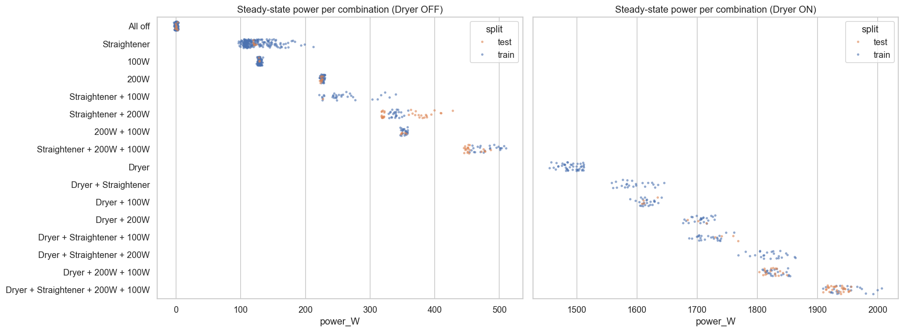
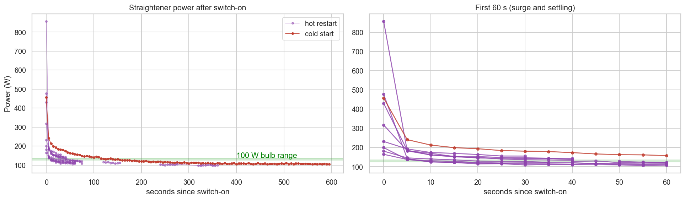
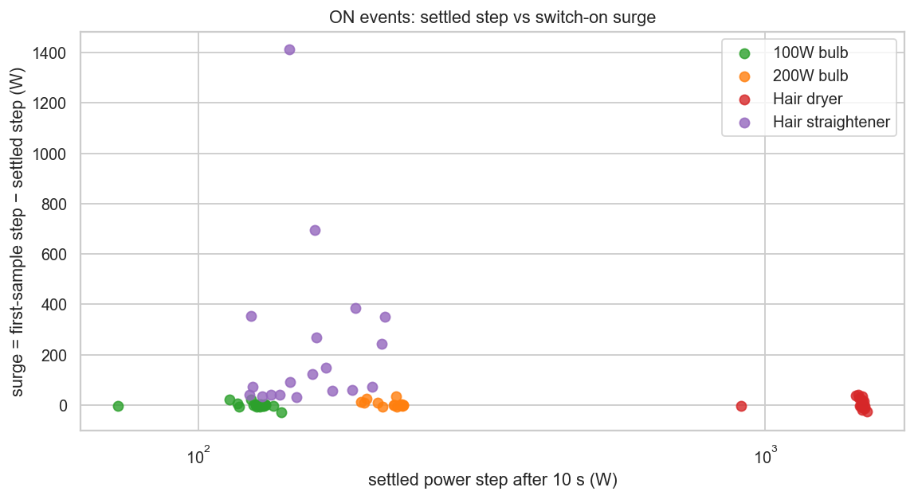
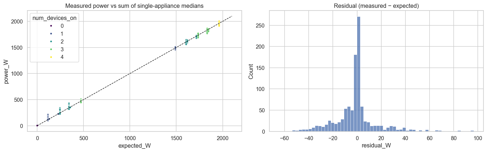

# LoRa SmartMeter Model

Real-time **appliance detection** (non-intrusive load monitoring) from a single smart energy meter.
The meter (STPM33 metering IC on an STM32 NUCLEO-G071RB) measures the total voltage, current, power and power
factor of a socket. The ML model reads that stream (sent over Wi-Fi) and predicts **which of four appliances
are ON** at any moment:

| Appliance | Typical power | Power factor |
|---|---|---|
| Hair dryer | ≈ 1,490 W | 1.00 |
| 200 W bulb | ≈ 227 W | 1.00 |
| 100 W bulb | ≈ 129 W | ≈ 1.00 |
| Hair straightener | 97 – 213 W (falls as it heats) | ≈ 0.96 |

---

## Project pipeline

| Step | Notebook | Status |
|---|---|---|
| 1. Data loading & validation | [`01_data_loading.ipynb`](notebooks/01_data_loading.ipynb) | ✅ Done |
| 2. Exploratory data analysis | [`02_eda.ipynb`](notebooks/02_eda.ipynb) | ✅ Done |
| 3. Feature engineering | `03_feature_engineering.ipynb` | ⏳ Next |
| 4. Model A: snapshot classifiers + hyper-parameter tuning | `04_model_A_snapshot.ipynb` | ⏳ |
| 5. Model B: event-based detector | `05_model_B_event.ipynb` | ⏳ |
| 6. Final comparison (incl. hybrid model) | `06_final_comparison.ipynb` | ⏳ |
| 7. Real-time Wi-Fi inference | `realtime/` | ⏳ |

---

## Dataset

Recorded on 21 Nov 2026 with firmware v0.3.0, in two sessions (morning and evening). Every one of the
**16 on/off combinations** of the four appliances is present.

- `data/raw/labelled_dataset.csv`: 1,370 labelled samples at a 5-second resolution (1,187 train / 183 test)
- `data/raw/switch_events.csv`: 148 appliance switch events
- `data/raw/*.log`: raw serial-console captures of the meter
- `data/raw/DATASET_README.md`: recording protocol and dataset notes

Source: `latestdataset/` of [abhigyankesri/LoRaWAN-Smart-Meter](https://github.com/abhigyankesri/LoRaWAN-Smart-Meter).

**Model inputs:** power, current and power factor (plus features derived from their recent history).
Voltage, frequency, energy and the sample counter are excluded (see EDA, section 7).

**Evaluation:** hyper-parameters are tuned with *leave-one-block-out* cross-validation (one protocol block per
fold). The final score is measured only on the untouched `F_test` block (free household-style use).

---

## Key EDA findings

**1. Appliance combinations and their power.** The dryer splits the data into two clear groups. Inside each group,
combinations containing the straightener overlap with combinations containing the 100 W bulb.



**2. The hard pair: hair straightener vs 100 W bulb.** Once hot, the straightener draws ≈ 105 – 130 W, inside the
100 W bulb's range. It is easy to recognise at switch-on (surge, then decaying power), which motivates an
event-based model.



**3. Switch-on signatures.** At the moment of switching, the bulbs give a clean step, the straightener a surge, and
the dryer a huge step.



**4. Loads are additive.** Total power ≈ sum of the individual appliance powers (residual spread ≈ ±18 W), so a
power-sum consistency check can correct the event-based model.



More charts: [`reports/figures/`](reports/figures/)

---

## Repository structure

```
LoRa_SmartMeter_Model/
├── data/
│   ├── raw/                 # original logs, labelled dataset, switch events
│   └── processed/           # generated by the notebooks (not tracked)
├── notebooks/               # step-by-step analysis and modelling
├── src/                     # reusable code (config, data loading / log parsing, features, models)
├── realtime/                # live Wi-Fi inference
├── models/                  # trained models (generated)
├── reports/figures/         # charts used in this README
└── requirements.txt
```

## How to run

```bash
python -m venv .venv
.venv\Scripts\activate          # Windows  (Linux/macOS: source .venv/bin/activate)
pip install -r requirements.txt
jupyter lab notebooks/
```

Run the notebooks in order (`01` → `06`).
